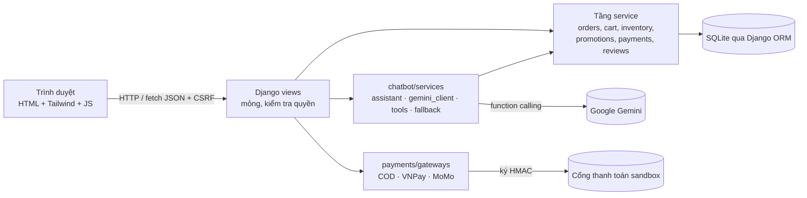

# iParts Store

**Đề tài:** Nghiên cứu và xây dựng hệ thống thương mại điện tử kinh doanh linh kiện thay thế iPhone, tích hợp chatbot AI hỗ trợ tư vấn và tra cứu linh kiện tương thích.

## 1. Tính năng chính
- **Website khách hàng:** trang chủ, danh mục, tìm kiếm (có dấu/không dấu), lọc, sắp xếp, chi tiết sản phẩm kèm ô "Kiểm tra máy của bạn", **tra cứu linh kiện tương thích** theo dòng iPhone.
- **Mua hàng:** giỏ hàng AJAX, mã giảm giá, checkout (COD / VNPay / MoMo), theo dõi, hủy và mua lại đơn hàng, đánh giá sản phẩm, danh sách yêu thích, sổ địa chỉ.
- **Tài khoản:** đăng ký, đăng nhập bằng email hoặc username, đăng nhập Google, quên/đổi mật khẩu.
- **iParts AI Assistant:** chatbot dùng Gemini function calling để truy vấn DB thật, có chế độ dự phòng khi chưa có API key.
- **Admin Panel `/quan-tri/`:** dashboard 5 biểu đồ; quản lý sản phẩm, tương thích (danh sách + ma trận), kho, đơn hàng, thanh toán, khách hàng, đánh giá, khuyến mãi, chatbot, nội dung, tài khoản Admin; báo cáo xuất CSV.

## 2. Công nghệ
Python 3.11+ · Django 6 · SQLite · Django Templates · Tailwind CSS 3 (build local) · JavaScript thuần (ES modules) · Chart.js · Lucide Icons · django-allauth (Google OAuth) · google-genai (Gemini).

## 3. Kiến trúc



```
weblk/
├── config/        settings, urls
├── core/          StoreSetting, Page, FAQ, Banner, phân quyền, filter vnd, lệnh seed
├── accounts/      User, hồ sơ, địa chỉ, đăng nhập, adapter Google
├── products/      Category, Brand, IPhoneModel, Product, Compatibility, tra cứu
├── cart/          giỏ hàng, yêu thích        ├── orders/     đơn hàng, checkout, máy trạng thái
├── payments/      Payment, gateways/         ├── inventory/  nhập/xuất kho
├── reviews/       đánh giá                   ├── promotions/ mã giảm giá
├── chatbot/       iParts AI Assistant        ├── dashboard/  Admin Panel + services/revenue.py
├── templates/  static/ (src/input.css → css/tailwind.css, js/, vendor/, images/brand/)
├── docs/          SPEC, PROGRESS, DECISIONS, ERD, TEST_REPORT, GIAI_THICH_BAO_VE
└── _archive/      code cũ trước khi làm lại
```

## 4. Cài đặt trên Windows
```powershell
# 1. Cài Python 3.11+ từ python.org (tick "Add Python to PATH")
cd "D:\Web Linh kien\weblk"
python -m venv venv
venv\Scripts\activate
pip install -r requirements.txt

# 2. Tạo file cấu hình
copy .env.example .env
#    Mở .env, điền SECRET_KEY (tạo bằng lệnh dưới)
python -c "import secrets; print(secrets.token_urlsafe(50))"

# 3. Tạo DB, dữ liệu mẫu và tài khoản demo
python manage.py migrate
python manage.py seed_data
python manage.py create_demo_accounts

# 4. Chạy
python manage.py runserver
```
Mở http://127.0.0.1:8000/ (website) và http://127.0.0.1:8000/quan-tri/ (Admin).

File `static/css/tailwind.css` đã được build sẵn. Bạn chỉ cần Node.js khi muốn sửa giao diện:
```powershell
npm install
npm run dev     # theo dõi thay đổi
npm run build   # build bản thu gọn
```

## 5. Biến môi trường
| Biến | Ý nghĩa | Bắt buộc | Ví dụ |
|---|---|---|---|
| `SECRET_KEY` | Khóa bí mật Django | Có (khi `DEBUG=False`) | chuỗi ngẫu nhiên 50 ký tự |
| `DEBUG` | Chế độ phát triển | Không | `True` |
| `ALLOWED_HOSTS`, `CSRF_TRUSTED_ORIGINS` | Host hợp lệ | Không | `127.0.0.1,localhost` |
| `DEMO_ADMIN_PASSWORD`, `DEMO_CUSTOMER_PASSWORD` | Mật khẩu tài khoản demo | Không (trống → sinh ngẫu nhiên) | |
| `EMAIL_BACKEND`, `EMAIL_HOST_USER`, `EMAIL_HOST_PASSWORD`... | Gửi email | Không (mặc định in ra console) | |
| `GOOGLE_CLIENT_ID`, `GOOGLE_CLIENT_SECRET` | Đăng nhập Google | Không | |
| `GEMINI_API_KEY`, `GEMINI_MODEL`, `GEMINI_TIMEOUT_SECONDS` | Chatbot AI | Không (trống → chế độ cơ bản) | `gemini-3.8-flash` (hoặc `gemini-3.5-flash`) |
| `VNPAY_TMN_CODE`, `VNPAY_HASH_SECRET`, `VNPAY_RETURN_URL` | VNPay Sandbox | Không (trống → "Đang bảo trì") | |
| `MOMO_PARTNER_CODE`, `MOMO_ACCESS_KEY`, `MOMO_SECRET_KEY`, `MOMO_*_URL` | MoMo Sandbox | Không | |

## 6. Cấu hình dịch vụ ngoài
### Google OAuth
1. Vào Google Cloud Console → tạo project.
2. **OAuth consent screen**: chọn External, thêm email của bạn vào Test users.
3. **Credentials → Create OAuth Client ID** → chọn loại *Web application*:
   - Authorized JavaScript origins: `http://127.0.0.1:8000`, `http://localhost:8000`
   - Authorized redirect URIs: `http://127.0.0.1:8000/accounts/google/login/callback/`, `http://localhost:8000/accounts/google/login/callback/`
4. Chép Client ID và Secret vào `.env`, rồi khởi động lại server. Lưu ý: phải truy cập website bằng đúng host đã khai báo.

### Gemini API
Lấy key tại Google AI Studio (aistudio.google.com) → điền `GEMINI_API_KEY` → khởi động lại → kiểm tra tại **Admin → iParts AI Assistant → Kiểm tra kết nối**.

### SMTP Gmail
Bật xác minh 2 bước → tạo **App Password** → `EMAIL_BACKEND=django.core.mail.backends.smtp.EmailBackend`, `EMAIL_HOST_USER=<gmail>`, `EMAIL_HOST_PASSWORD=<app password>`.

### VNPay Sandbox
Đăng ký tại sandbox.vnpayment.vn → nhận `TMN_CODE` và `HASH_SECRET` → điền `.env`. VNPay không gọi được IPN vào `127.0.0.1`, nên trong môi trường dev Return URL (đã xác minh chữ ký) sẽ cập nhật trạng thái thanh toán. Muốn thử IPN: chạy `ngrok http 8000` rồi khai báo URL `https://<ngrok>/thanh-toan/vnpay/ipn/` trong trang quản trị sandbox.

### MoMo Sandbox
Đăng ký tài khoản test tại developers.momo.vn → điền `MOMO_PARTNER_CODE`, `MOMO_ACCESS_KEY`, `MOMO_SECRET_KEY`. IPN (`/thanh-toan/momo/ipn/`) cũng cần ngrok giống VNPay.

## 7. Tài khoản demo
Chạy `python manage.py create_demo_accounts`. Lệnh tạo:
- Admin (Superuser): `admin` / `admin@iparts.local`
- Customer: `khachdemo` / `khachdemo@iparts.local`

Mật khẩu lấy từ `DEMO_ADMIN_PASSWORD` / `DEMO_CUSTOMER_PASSWORD` trong `.env`. Nếu để trống, lệnh sẽ sinh mật khẩu ngẫu nhiên và in ra **một lần**. Dùng `--reset-password` để đặt lại. Các khách mẫu `khach01..15@example.com` do `seed_data` tạo không đăng nhập được.

## 8. Phân quyền
| Chức năng | Guest | Customer | Admin |
|---|:-:|:-:|:-:|
| Xem sản phẩm, tra cứu tương thích, chatbot | ✔ | ✔ | ✔ |
| Giỏ hàng, đặt hàng, yêu thích, đánh giá | ✖ (hiện modal đăng nhập) | ✔ | ✖ |
| Khu vực tài khoản, đơn của tôi | ✖ | ✔ (chỉ dữ liệu của mình) | ✖ |
| `/quan-tri/` | → trang đăng nhập Admin | 403 | ✔ |
| Quản lý tài khoản Admin, `/django-admin/` | ✖ | ✖ | Chỉ Superuser |

Mọi quyền đều được kiểm tra ở backend (`core/permissions.py`), kể cả khi gọi thẳng URL hoặc API.

## 9. Quy tắc nghiệp vụ chính
- **Tồn kho:** trừ ngay khi tạo đơn, hoàn lại khi hủy hoặc quá hạn thanh toán online (15 phút). Mọi thay đổi đều đi qua `adjust_stock` và được ghi lịch sử.
- **Trạng thái đơn:** Chờ xác nhận → Đã xác nhận → Đang chuẩn bị → Đang giao → Giao thành công (hoặc Đã hủy). Chỉ một hàm `change_order_status` được phép đổi trạng thái.
- **Doanh thu:** tổng tiền các đơn *Giao thành công* và *Đã thanh toán*, tính theo ngày giao (giờ VN). Doanh thu theo danh mục/sản phẩm là **doanh thu trước giảm giá coupon**.
- **Tương thích:** chỉ khẳng định với quan hệ `verified`. Dữ liệu tương thích do seed tạo là **dữ liệu minh họa**, không khẳng định thông số thực tế.
- **Chatbot chống bịa dữ liệu:** AI chỉ trả lời dựa trên kết quả tool truy vấn DB. Thẻ sản phẩm do backend dựng. AI không tự đặt hàng. Chi tiết xem `docs/GIAI_THICH_BAO_VE.md`.
- Ảnh sản phẩm mẫu được sinh bằng Pillow. Admin có thể thay bằng ảnh thật trong form sản phẩm.

## 10. Chạy test
```powershell
python manage.py test
```
Kết quả hiện tại: 50 test đều đạt. Xem `docs/TEST_REPORT.md`.

## 11. Lỗi thường gặp
| Lỗi | Cách xử lý |
|---|---|
| `Thiếu SECRET_KEY trong file .env` | Sao chép `.env.example` thành `.env` và điền `SECRET_KEY` |
| Port 8000 đang bận | `python manage.py runserver 8001` (nhớ cập nhật redirect URI Google/VNPay theo port mới) |
| Google báo `redirect_uri_mismatch` | Khai báo đúng `http://127.0.0.1:8000/accounts/google/login/callback/` và truy cập bằng đúng host đó |
| Gemini báo hết quota / lỗi | Chatbot tự chuyển sang chế độ cơ bản; kiểm tra key và quota trong AI Studio |
| Ảnh sản phẩm không hiển thị | Chạy `python manage.py seed_data`. Khi `DEBUG=False`, Django không phục vụ `/media/`, cần web server |
| Lỗi font tiếng Việt khi chạy lệnh trên console | Đã xử lý trong `manage.py`; nếu vẫn lỗi, chạy `chcp 65001` trước |

## 12. Giới hạn và hướng phát triển
- Rate limit dùng cache trong bộ nhớ. Khi chạy nhiều tiến trình nên chuyển sang Redis.
- Địa chỉ tỉnh/huyện/xã đang nhập tự do. Có thể thêm dropdown từ dữ liệu hành chính.
- Có thể bổ sung: nhật ký thao tác Admin, phân quyền chi tiết bằng Django Groups, thông báo email/Zalo khi đổi trạng thái đơn, triển khai PostgreSQL + HTTPS.
